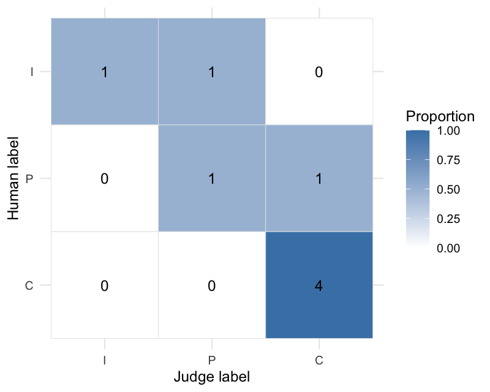

<p align="center">
  
</p>

<p align="center"><b>An LLM-as-judge is a measurement instrument. Calibrate it blind against human raters, put an interval on every estimate, probe it for bias, and let an explicit policy say what the evidence shows before its grades decide anything.</b></p>

<p align="center">
  <a href="https://github.com/JsizzleR/yourhonor/actions/workflows/R-CMD-check.yaml"></a>
  <a href="https://lifecycle.r-lib.org/articles/stages.html#experimental"></a>
  <a href="LICENSE.md"></a>
  <a href="DESCRIPTION">= 4.1"></a>
</p>

## What it measures

`yourhonor` fills a gap around the [ellmer](https://ellmer.tidyverse.org) and
[vitals](https://vitals.tidyverse.org) workflow. It does not run evaluations
and it calls no model unless you hand it a judge function; it measures the
judge that scores them, and says in plain terms what that measurement does and
does not support.

- **Blind calibration.** `calibrate_judge()` compares judge labels with one or
  more human raters. A live judge sees only the columns listed in
  `input_cols`, never the human labels: rows are shuffled before opaque keys
  are assigned, keyed output is validated and restored to source order, and
  the judge-side key is kept so logs can be joined back without un-blinding
  the run.
- **Agreement with intervals.** `agreement()` reports Cohen's kappa,
  Krippendorff's alpha, and Gwet's AC1 (nominal) or AC2 (weighted) with
  item-bootstrap intervals, a fixed label universe, and explicit missingness.
  Weighted analyses require a declared order.
- **Per-class error.** `confusion_metrics()` reports class support, precision,
  and recall with exact intervals, so a high aggregate score cannot hide
  failure on a rare but important class.
- **Bias probes.** `probe_bias()` tests pointwise verbosity, self-preference,
  and bandwagon effects. `probe_position()` swaps separate candidate columns
  through neutral display slots and maps choices back to stable candidate
  identity. Both return one schema, record raw missingness, and report
  conservative directional-effect intervals.
- **Test-retest stability.** `test_retest()` reports pairwise run disagreement
  with a conservative interval, rather than an any-flip rate that rises
  mechanically with the number of runs.
- **An explicit policy.** `acceptance_policy()` makes every threshold a
  declared parameter. `report()` returns a `yourhonor_report` whose
  `$decision` is `PASS`, `FAIL`, `NOT_ASSESSED`, or `INDETERMINATE`; without a
  policy it is descriptive, and it never implies that missing evidence passed.
- **vitals and artifacts.** `audit_vitals()` consumes grades already present in
  a vitals task without another model call; `stability_vitals()` reuses
  epochs whose judge-visible content stayed invariant. `write_audit()` writes
  Markdown or a versioned, language-neutral JSON summary, never item rows, and
  never over an existing file unless told to.

## Install

Requires R 4.1 or later. `ggplot2` is needed only for `plot_confusion()`, and
`jsonlite` only for JSON artifacts.

```r
# install.packages("pak")
pak::pak("JsizzleR/yourhonor")
```

## What a run looks like

Grades already in hand: a data frame with a human column and a judge column.

```r
library(yourhonor)

gold <- tibble::tibble(
  human_label = c("C", "C", "P", "I", "C", "P", "I", "C"),
  judge_label = c("C", "C", "C", "I", "C", "P", "P", "C")
)

cal <- calibrate_judge(
  gold,
  label_levels = c("I", "P", "C"),
  scale = "ordinal",
  n_boot = 500,
  seed = 1
)
cal
#> ── yourhonor judge calibration ─────────────────────────────────────────────────
#> 8 usable items of 8 - descriptive judge-vs-human agreement:
#> • cohen_kappa: 0.76 [0.25, 1.00] (substantial)
#> • krippendorff_alpha: 0.77 [0.18, 1.00] (substantial)
#> • gwet_ac2: 0.81 [0.56, 1.00] (almost perfect)
#> 2 disagreements; inspect `confusion_metrics()` before use.
#> ℹ No deployment decision is implied; call report() with a policy to assess one.

agreement(cal)
confusion_metrics(cal)
#> # A tibble: 3 × 9
#>   label support predicted precision precision_conf_low precision_conf_high
#>   <chr>   <int>     <int>     <dbl>              <dbl>               <dbl>
#> 1 I           2         1       1               0.0250               1    
#> 2 P           2         2       0.5             0.0126               0.987
#> 3 C           4         5       0.8             0.284                0.995
#> # ℹ 3 more variables: recall <dbl>, recall_conf_low <dbl>,
#> #   recall_conf_high <dbl>

plot_confusion(cal)
```

<p align="center"></p>

```r
# Evidence alone is not a deployment decision.
rep <- report(cal, output = "md")
rep$decision
#> [1] "NOT_ASSESSED"
```

> **Real output.** Every `#>` block in this file, and the plot above, was
> produced by the code above it, run against the source at this commit
> (`seed = 1`, console width 80). The eight-item frames are synthetic API
> demonstrations, which is why their intervals are wide; the 200-item run
> further down is synthetic too, with its judge's flaw planted and no model
> called. Nothing here is a benchmark. The README is maintained by hand, so
> re-run the chunks after a change to an estimator.

`report()` returns the same `yourhonor_report` whichever `output` you choose;
`output` only sets how it prints. `rep$checks` is a tibble with one row per
policy check, and `format(rep, output = "md")` gives the Markdown lines.

## An audit that reaches a verdict

Eight items can only say `NOT_ASSESSED`. `synthetic_gold` is a 200-item set
with three simulated raters, built so an audit can finish: every label is
planted and the text is templated (`?synthetic_gold`, `data-raw/`). The judge
below reads the answer by keyword, adds a little run-to-run error, and carries
one planted flaw: an input longer than 240 characters is graded a level more
generously. Calibration cannot see that flaw, because no input is that long.
The probes can.

```r
keyword_judge <- function(data) {
  hedged <- grepl("probably|somewhere|should be|I think|I believe|might|sometimes|could", data$input)
  concrete <- grepl("Answer: (Open|Use|Yes)|click", data$input)
  label <- ifelse(hedged, "P", ifelse(concrete, "C", "I"))
  # The flaw under audit: a long input reads as one level more complete.
  long <- nchar(data$input) > 240
  label[long & label == "P"] <- "C"
  label[long & label == "I"] <- "P"
  # A little run-to-run error, so repeated runs are not identical.
  noise <- runif(nrow(data)) < 0.05
  label[noise] <- sample(c("I", "P", "C"), sum(noise), replace = TRUE)
  tibble::tibble(.item_id = data$.item_id, label = label)
}

cal <- calibrate_judge(
  synthetic_gold,
  judge = keyword_judge,
  human_cols = c("rater_1", "rater_2", "rater_3"),
  input_cols = c("input", "target"),
  id_col = "id",
  label_levels = c("I", "P", "C"),
  scale = "ordinal",
  n_boot = 500,
  seed = 1,
  provenance = list(model = "synthetic keyword judge", prompt_version = "v1"),
  audit_id = "synthetic-judge-v1"
)
cal
#> ── yourhonor judge calibration ─────────────────────────────────────────────────
#> 200 usable items of 200 - descriptive judge-vs-human agreement:
#> • cohen_kappa: 0.94 [0.89, 0.99] (almost perfect)
#> • krippendorff_alpha: 0.95 [0.89, 0.99] (almost perfect)
#> • gwet_ac2: 0.97 [0.93, 1.00] (almost perfect)
#> 5 disagreements; inspect `confusion_metrics()` before use.
#> Human reliability benchmark (3 raters): gwet_ac2 = 0.92.
#> ℹ No deployment decision is implied; call report() with a policy to assess one.

bias <- probe_bias(
  synthetic_gold,
  keyword_judge,
  input_cols = c("input", "target"),
  probes = c("verbosity", "self_preference", "bandwagon"),
  seed = 1,
  audit_id = "synthetic-judge-v1"
)
bias[, c("probe", "flip_rate", "directional_rate", "direction", "p_value_adj", "verdict")]
#> ── yourhonor bias probes ──
#> 
#> # A tibble: 3 × 6
#>   probe           flip_rate directional_rate direction       p_value_adj verdict
#>   <chr>               <dbl>            <dbl> <chr>                 <dbl> <chr>  
#> 1 verbosity           0.435            0.365 favors_perturb…    2.48e-16 BIAS   
#> 2 self_preference     0.085            0.035 favors_perturb…    2.87e- 1 no_sig…
#> 3 bandwagon           0.055            0.025 favors_perturb…    2.87e- 1 no_sig…

stability <- test_retest(
  synthetic_gold,
  keyword_judge,
  input_cols = c("input", "target"),
  n_runs = 5,
  label_levels = c("I", "P", "C"),
  weights = "ordinal",
  n_boot = 500,
  seed = 1,
  audit_id = "synthetic-judge-v1"
)
stability
#> ── yourhonor test-retest stability ──
#> 
#> 5 runs - pairwise disagreement 0.07 [0.05, 0.12].
#> gwet_ac2: 0.90 [0.87, 0.94].
#> Any-flip rate at exactly 5 runs: 0.18; missing judgments: 0.00.
```

Every piece of evidence carries the same `audit_id`; `report()` refuses to
bind evidence tagged for a different judge. Declare thresholds from the task's
error costs, not from a package-wide notion of a "good" score:

```r
policy <- acceptance_policy(
  min_agreement_lower = 0.75,
  min_n = 150,
  min_class_n = 20,
  min_recall = c(I = 0.80, P = 0.75, C = 0.85),
  min_precision = c(C = 0.85),
  max_missing_rate = 0.01,
  max_pairwise_disagreement = 0.10,
  min_stability_n = 150,
  min_stability_runs = 3,
  max_stability_missing_rate = 0.01,
  required_probes = c("verbosity", "self_preference", "bandwagon"),
  min_probe_n = 150,
  max_probe_flip_rate = 0.10,
  max_probe_directional_rate = 0.10,
  max_probe_missing_rate = 0.01,
  conf_level = 0.95,
  coefficient = "gwet_ac2"
)

verdict <- report(cal, bias = bias, stability = stability, policy = policy)
verdict
#> ── yourhonor assessment: FAIL ──────────────────────────────────────────────────
#> Judge evidence: n = 200 of 200.
#> Agreement evidence: gwet_ac2 = 0.97 [0.93, 1.00] (almost perfect).
#> Per-class evidence:
#> • "I": support 22, precision 0.91, recall 0.95
#> • "P": support 62, precision 0.98, recall 0.97
#> • "C": support 116, precision 0.98, recall 0.98
#> Human reliability benchmark: gwet_ac2 = 0.92.
#> Policy-failing bias checks: bias_verbosity_direction, bias_verbosity.
#> Pairwise disagreement: 0.07 [0.05, 0.12].
#> 
#> ── policy checks ──
#> 
#> PASS: usable_items = 200 (>= 150) - Sample size is sufficient.
#> PASS: calibration_confidence_level = 0.95 (= 0.95) - Confidence level matches
#> policy.
#> PASS: calibration_missing_rate = 0 (<= 0.01) - Criterion met.
#> PASS: agreement_gwet_ac2 = 0.905 (lower >= 0.75) - Interval clears threshold.
#> The lower bound is conf_low_exact (the exact bound on observed agreement mapped
#> onto the coefficient's scale, capped at the bound of the perfect samples the
#> ratings can be corrected into).
#> PASS: class_support = 22 (>= 20) - All classes meet support.
#> INDETERMINATE: recall_I = 0.772 (lower >= 0.8) - Interval overlaps threshold.
#> PASS: recall_P = 0.888 (lower >= 0.75) - Interval clears threshold.
#> PASS: recall_C = 0.939 (lower >= 0.85) - Interval clears threshold.
#> PASS: precision_C = 0.939 (lower >= 0.85) - Interval clears threshold.
#> PASS: bias_verbosity_missing_rate = 0 (<= 0.01) - Criterion met.
#> PASS: bias_verbosity_n = 200 (>= 150) - Sample size is sufficient.
#> FAIL: bias_verbosity_direction = 0.469 (upper <= 0.1) - Interval exceeds
#> threshold.
#> FAIL: bias_verbosity = 0.507 (upper <= 0.1) - Interval exceeds threshold.
#> PASS: bias_self_preference_missing_rate = 0 (<= 0.01) - Criterion met.
#> PASS: bias_self_preference_n = 200 (>= 150) - Sample size is sufficient.
#> INDETERMINATE: bias_self_preference_direction = 0.102 (upper <= 0.1) - Interval
#> overlaps threshold.
#> INDETERMINATE: bias_self_preference = 0.133 (upper <= 0.1) - Interval overlaps
#> threshold.
#> PASS: bias_bandwagon_missing_rate = 0 (<= 0.01) - Criterion met.
#> PASS: bias_bandwagon_n = 200 (>= 150) - Sample size is sufficient.
#> PASS: bias_bandwagon_direction = 0.0808 (upper <= 0.1) - Interval clears
#> threshold.
#> PASS: bias_bandwagon = 0.0963 (upper <= 0.1) - Interval clears threshold.
#> INDETERMINATE: stability_pairwise_disagreement = 0.119 (upper <= 0.1) -
#> Interval overlaps threshold.
#> PASS: stability_items = 200 (>= 150) - Sample size is sufficient.
#> PASS: stability_runs = 5 (>= 3) - Sample size is sufficient.
#> PASS: stability_missing_rate = 0 (<= 0.01) - Criterion met.

verdict$decision
#> [1] "FAIL"
```

Agreement with the human consensus is almost perfect and clears the floor;
the judge is still not deployable, because the verbosity probe found the
planted flaw and both its checks fail. The three `INDETERMINATE` rows are the
other half of the honesty: 22 incorrect answers cannot pin recall on `I` to
0.80, self-preference came back `no_signal` yet its interval cannot exclude
0.10, and pairwise disagreement of 0.07 has an upper bound of 0.12. None of
those is a `PASS`, and none is reported as one.

Stability and probe thresholds live behind their gates
(`max_pairwise_disagreement` and `required_probes`). Supplying one without its
gate is an error, so a policy never carries a threshold that is not assessed.
Required evidence that was never supplied is `NOT_ASSESSED`, never silently
passed.

## A live judge sees no labels

A judge function receives a shuffled, redacted data frame with a fresh opaque
`.item_id`. Returning that key with the label lets `yourhonor` verify and
restore row order. A caller ID is never exposed unless it is listed in
`input_cols`.

![The blind-judge contract. Left, what the caller holds: the gold frame with id (validated, never sent), input and target (in input_cols, sent), human_label and judge_label (protected), and .item_id (reserved); naming a protected column in input_cols is an error, not a convention. Middle, the path a row takes: redact to the input columns, sanitize away row-aligned names and attributes, shuffle with sample.int, key with .item_id 1..n assigned after the shuffle, validate that every issued key comes back exactly once with a label in label_levels, restore the labels to source order. Right, what the judge sees: .item_id, input, target and nothing else, and what it returns: a data frame keyed by the issued key or one bare label per row. Bottom: the result keeps both keys, .item_id for the source row and .judge_item_id for the key the judge saw, with a blinding map between them.](man/figures/blind-judge.svg)

> **A drawing, nothing captured** (hand-authored 2026-11-02, from the
> blind-grading path in `R/calibrate.R`). The one rule it shows: the judge
> gets the input columns and a key, and the key is minted after the shuffle,
> so neither source order nor an id can carry a label across.

```r
model_judge <- function(data) {
  # Replace this body with ellmer calls using data$input and data$target.
  tibble::tibble(
    .item_id = data$.item_id,
    label = rep("C", nrow(data))
  )
}

cal <- calibrate_judge(
  support_gold,
  judge = model_judge,
  input_cols = c("input", "target"),
  id_col = "id",
  label_levels = c("I", "P", "C"),
  scale = "ordinal",
  provenance = list(model = "provider/model", prompt_version = "judge-v3"),
  audit_id = "support-judge-v3-gold-2026-08",
  seed = 1
)
```

`input_cols` is required for a live judge. Human-rating columns and an existing
judge-label column are rejected if included, making leakage an API error rather
than a convention. The `.item_id` the judge sees is assigned after shuffling;
`cal$items$.judge_item_id` records it so judge-side logs can be joined back.

## Position bias needs structured candidates

Position is not a text-regex perturbation. Keep candidates separate so their
identity survives the swap:

```r
pairs <- tibble::tibble(
  question = c("2 + 2?", "Capital of France?"),
  candidate_a = c("4", "Paris"),
  candidate_b = c("5", "Berlin")
)

pairwise_judge <- function(data) {
  # Candidate text is in neutral .candidate_1/.candidate_2 display slots.
  # Return A/B in display space. This example always picks the first candidate.
  rep("A", nrow(data))
}

probe_position(
  pairs,
  pairwise_judge,
  candidate_a_col = "candidate_a",
  candidate_b_col = "candidate_b",
  context_cols = "question",
  repeats = 2,
  seed = 1,
  audit_id = "pairwise-judge-v1"
)
#> ── yourhonor bias probes ──
#> 
#> # A tibble: 1 × 32
#>   probe    flip_rate conf_low conf_high direction    directional_rate
#>   <chr>        <dbl>    <dbl>     <dbl> <chr>                   <dbl>
#> 1 position         1    0.158         1 favors_first                1
#> # ℹ 26 more variables: directional_conf_low <dbl>, directional_conf_high <dbl>,
#> #   position_preference <dbl>, display_first_rate <dbl>,
#> #   position_conf_low <dbl>, position_conf_high <dbl>, statistic <int>,
#> #   n_discordant <int>, n_scored <int>, n_directional_items <int>,
#> #   n_input <int>, n_unscored <int>, unscored_rate <dbl>,
#> #   n_items_missing <int>, n_judgments <int>, n_judgments_missing <int>,
#> #   missing_rate <dbl>, n_comparisons <int>, p_value <dbl>, …
```

Pointwise and position probes share this schema; `?probe_bias` documents every
column and its denominator. Two items cannot reach significance, so the verdict
here is `no_signal` despite a total preference for the first slot: use
`min_probe_n` in a policy to require a real sample.

## Grades already in a vitals task

```r
# task$eval() has already populated task$get_samples()$score.
human <- tibble::tibble(
  id = human_review$id,
  human_label = human_review$label
)

cal <- audit_vitals(
  task,
  human_labels = human,
  label_levels = c("I", "P", "C"),
  scale = "ordinal",
  provenance = list(judge_prompt = "grader-v3"),
  audit_id = "support-judge-v3-gold-2026-08",
  seed = 1
)

# An existing file is an error unless overwrite = TRUE.
write_audit(cal, "judge-audit.json", policy = policy, format = "json")
```

Vitals tasks with multiple epochs contain repeated IDs. Filter to one epoch for
calibration. To reuse epochs as judge-stability evidence, list every
judge-visible field and require it to remain invariant:

```r
stability <- stability_vitals(
  task,
  content_cols = c("input", "target", "result"),
  label_levels = c("I", "P", "C"),
  weights = "ordinal",
  audit_id = "support-judge-v3-gold-2026-08",
  seed = 1
)
```

If solver output changes between epochs, this adapter refuses the claim: those
rows measure end-to-end evaluation variation, not judge test-retest stability.

JSON artifacts omit `cal$items`, but caller-supplied provenance is written
verbatim: do not place secrets or raw item content in provenance fields. The
`yourhonor.audit.v1` schema is documented in `?write_audit`. Numbers are
written at full precision (17 significant digits, so every double round-trips
exactly), absent values are `null`, and vector fields are always arrays. The
precision is the stored doubles', not the estimates': irrCAC rounds each
agreement coefficient to five decimals.

## Raw rating frames

`agreement()`, `confusion()`, and `plot_confusion()` also accept a plain data
frame. Name the columns explicitly (`rater_cols` for `agreement()`,
`human_col`/`judge_col` for `confusion()`); when you do not, columns named
`human` and `judge` are used if both exist, and any other inference is
announced with a message so a wide frame is never silently misread:

```r
ratings <- data.frame(
  id = 1:4,
  human = c("C", "C", "P", "I"),
  judge = c("C", "P", "P", "I")
)
confusion(ratings, label_levels = c("I", "P", "C"))
#> ℹ Using human and judge as the rating columns.
#> ℹ Ignoring column: id.
#>   Set `human_col` and `judge_col` to choose explicitly.
#> # A tibble: 9 × 4
#>   human_label judge_label     n  prop
#>   <chr>       <chr>       <int> <dbl>
#> 1 I           I               1  0.25
#> 2 P           I               0  0   
#> 3 C           I               0  0   
#> 4 I           P               0  0   
#> 5 P           P               1  0.25
#> 6 C           P               1  0.25
#> 7 I           C               0  0   
#> 8 P           C               0  0   
#> 9 C           C               1  0.25
```

## How it holds together

Each function returns an evidence object (`calibrate_judge()`, the probes,
`test_retest()`, the vitals adapters) that prints descriptively and carries its
own missingness and provenance. `acceptance_policy()` is the only place a
threshold lives. `report()` joins the two into a decision and a tibble of
checks; `write_audit()` serialises that report, not the items. Three rules run
through all of it:

- **Evidence is never a decision.** Without a policy every object is
  descriptive; with one, evidence a policy requires but was not given is
  `NOT_ASSESSED`, and an interval that straddles its threshold is
  `INDETERMINATE`. Acceptance is an all-criteria gate.
- **The judge never sees the answer key.** Redaction is enforced by the API,
  not by convention: label columns passed to a live judge are an error,
  shuffling precedes keying, and keyed output is checked before it is
  restored.
- **Intervals err toward the user.** Zero-width bootstraps at empirically
  perfect agreement are flagged unreliable rather than reported as certainty;
  the stability interval is widened by a Wilson bound, never narrowed; the
  policy's agreement check uses an exact lower bound mapped onto the
  coefficient's scale.

### Reading the evidence

- Human-human agreement is a reliability benchmark, not a ceiling. A judge can
  agree with a consensus more strongly than individual humans agree with each
  other.
- With several human raters, each item's reference label is the modal (most
  frequent) human label. Items whose top labels tie have no consensus and are
  excluded from the judge-versus-consensus evidence (`n_consensus_ties`). With
  two raters every disagreement is a tie, so the judge is scored only on the
  items humans agreed about; that direction is optimistic. `per_rater_agreement`
  compares the judge against each rater on every item.
- The test-retest pairwise-disagreement interval is a hybrid: the percentile
  item bootstrap widened to include a Wilson score interval for the mean
  per-item disagreement. It keeps a zero-disagreement sample from producing a
  zero-width interval, usually sets both bounds once there are more than two
  runs, and can only widen the bootstrap, never narrow it. The chance-corrected
  stability interval is the plain item bootstrap.
- `no_signal` from a bias probe means the probe did not detect a directional
  effect. It is not proof that the judge is unbiased. A `BIAS` verdict needs
  both a small adjusted p-value and a net `directional_rate` above
  `flip_threshold`; a large but balanced flip rate is reported, not flagged.
- A single observed class cannot identify chance-corrected agreement. Such
  results are `INDETERMINATE`, not perfect.
- Aggregate agreement never substitutes for class-specific error requirements.

## Posture

**Cost.** The package makes no model calls of its own. A live judge runs only
when you pass one to `calibrate_judge()`, `probe_bias()`, `probe_position()`
or `test_retest()`; `audit_vitals()` and `stability_vitals()` reuse grades a
task already paid for.
**Scope.** Calibration and stability intervals treat rows as independent
sampling units. Repeated templates, conversations, users, or other clusters
must be reduced to independent units or analysed with a cluster-aware method
outside this package; vitals epochs are repeated measurements, not extra
items. Freeze a representative, held-out gold set before tuning the judge or
prompt, and record the split, version, hash, and model and prompt versions in
`provenance`: reusing a tuning set is not an independent audit. Confidence
levels apply to each interval, not to a simultaneous band over every displayed
estimate. `support_gold` (eight items) and `synthetic_gold` (200 items, planted
labels, templated text) are API demonstrations, not benchmarks.
**Privacy.** A live judge sees only `input_cols`. JSON artifacts carry
aggregates and provenance, never item rows; provenance is written verbatim, so
it is the caller's to keep free of secrets and raw content.
**Status.** Experimental and unreleased (`0.0.0.9000`). `R CMD check` with
the test suite runs on every push and pull request. Agreement estimators are
delegated to [irrCAC](https://cran.r-project.org/package=irrCAC); the
package's own contribution is the judge-safe workflow, the conservative
evidence model, and the R/vitals integration around them. A JSON artifact is a
portable aggregate summary; independent reproduction still needs the frozen
data, the judge configuration, and the code.

## Documentation

| Document | What it is |
| --- | --- |
| [`vignette("yourhonor")`](vignettes/yourhonor.Rmd) | The end-to-end walkthrough: a gold set, the blind judge contract, rare classes, several raters, pointwise probes, repeatability, a policy decision, an artifact, vitals scores, statistical scope |
| `?acceptance_policy`, `?report` | Every threshold, its gate, and how a check becomes `PASS`, `FAIL`, `NOT_ASSESSED` or `INDETERMINATE` |
| `?probe_bias`, `?probe_position` | Every probe column and its denominator |
| `?write_audit` | The `yourhonor.audit.v1` JSON schema |
| [NEWS.md](NEWS.md) | The feature set as it stands and the review fixes early adopters should know about |

## License

[MIT](LICENSE.md) © yourhonor authors
