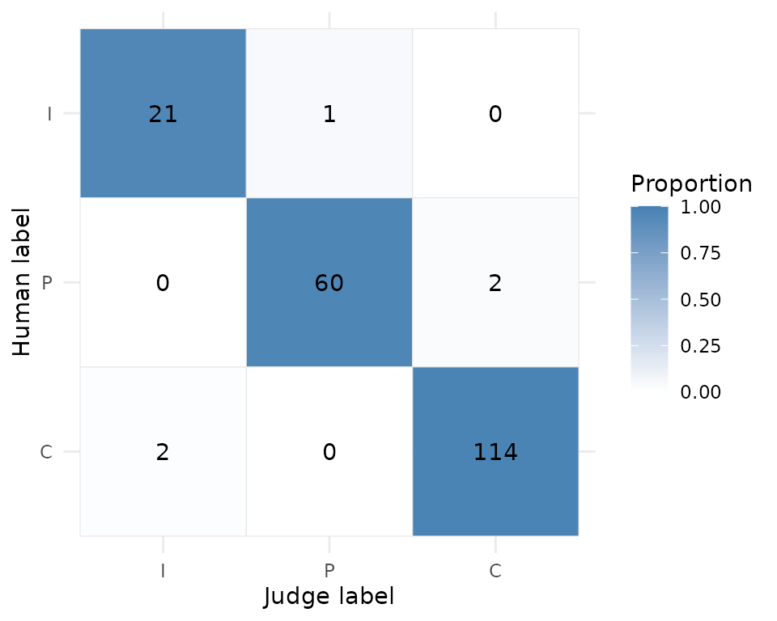

# Audit an LLM judge

``` r

library(yourhonor)
```

An LLM judge is a measurement instrument. Before its scores drive a
launch, ranking, or regression gate, we need evidence about agreement
with humans, class-specific errors, bias sensitivity, and repeatability.
`yourhonor` assembles that evidence, but it does not invent a universal
definition of “good enough.”

This walkthrough audits **one** judge end to end. Every piece of
evidence is tagged with the same `audit_id`, and
[`report()`](https://jsizzler.github.io/yourhonor/reference/report.md)
only binds evidence that shares that tag. The judge is synthetic, so no
model is called, but it has a flaw that a real judge might have: it
reads long answers as more complete than short ones. The audit is
designed to find that flaw.

## Start from a gold set

A calibration set needs stable item IDs, content the judge may see, and
blind human labels. `synthetic_gold` is a 200-item set of support-style
questions and answers with three simulated raters. Every label in it is
planted: a true label was drawn per item, the answer text was written to
match it (correct answers name a place and an action, partial answers
hedge, incorrect answers deflect), and each rater reads the truth with a
6% chance of an adjacent-level slip. The text is templated, so no row is
a real ticket; what is independent across rows, and what the item
bootstrap relies on, is the draw of the label and of each rater’s error
([`?synthetic_gold`](https://jsizzler.github.io/yourhonor/reference/synthetic_gold.md),
`data-raw/synthetic_gold.R`).

``` r

synthetic_gold
#> # A tibble: 200 × 6
#>    id      input                                  target rater_1 rater_2 rater_3
#>    <chr>   <chr>                                  <chr>  <ord>   <ord>   <ord>  
#>  1 syn-001 "Question 1: How do I upgrade my plan… Does … C       C       C      
#>  2 syn-002 "Question 2: Is two-factor authentica… Does … I       I       I      
#>  3 syn-003 "Question 3: Can I get a refund for l… Does … P       P       I      
#>  4 syn-004 "Question 4: Why does my import fail?… Does … C       P       C      
#>  5 syn-005 "Question 5: What are your support ho… Does … P       P       P      
#>  6 syn-006 "Question 6: Does the API have rate l… Does … C       C       C      
#>  7 syn-007 "Question 7: Why is my dashboard slow… Does … C       C       C      
#>  8 syn-008 "Question 8: How do I reset my passwo… Does … C       C       C      
#>  9 syn-009 "Question 9: What file types can I up… Does … I       I       I      
#> 10 syn-010 "Question 10: How do I upgrade my pla… Does … P       P       P      
#> # ℹ 190 more rows
```

## Use a blind judge contract

When a live judge is supplied, `input_cols` is required. The function
receives only a generated `.item_id` and those declared columns. Human
labels are never passed to it. A keyed data-frame result is safest
because row reordering becomes detectable.

The judge below grades by keyword (a hedge reads as partial, a concrete
instruction as correct, anything else as incorrect), adds a little
random error so that repeated runs are not identical, and carries the
deliberate flaw: any input longer than 240 characters is graded one
level more generously.

``` r

keyword_judge <- function(data) {
  hedged <- grepl("probably|somewhere|should be|I think|I believe|might|sometimes|could", data$input)
  concrete <- grepl("Answer: (Open|Use|Yes)|click", data$input)
  label <- ifelse(hedged, "P", ifelse(concrete, "C", "I"))
  # The flaw under audit: a long input reads as one level more complete.
  long <- nchar(data$input) > 240
  label[long & label == "P"] <- "C"
  label[long & label == "I"] <- "P"
  # A little run-to-run error, so repeated runs are not identical.
  noise <- runif(nrow(data)) < 0.05
  label[noise] <- sample(c("I", "P", "C"), sum(noise), replace = TRUE)
  tibble::tibble(.item_id = data$.item_id, label = label)
}

cal <- calibrate_judge(
  synthetic_gold,
  judge = keyword_judge,
  human_cols = c("rater_1", "rater_2", "rater_3"),
  input_cols = c("input", "target"),
  id_col = "id",
  label_levels = c("I", "P", "C"),
  scale = "ordinal",
  n_boot = 200,
  seed = 1,
  provenance = list(model = "synthetic keyword judge", prompt_version = "v1"),
  audit_id = "synthetic-judge-v1"
)
cal
#> 
#> ── yourhonor judge calibration ─────────────────────────────────────────────────
#> 200 usable items of 200 - descriptive judge-vs-human agreement:
#> • cohen_kappa: 0.94 [0.88, 0.99] (almost perfect)
#> • krippendorff_alpha: 0.95 [0.88, 0.99] (almost perfect)
#> • gwet_ac2: 0.97 [0.93, 0.99] (almost perfect)
#> 5 disagreements; inspect `confusion_metrics()` before use.
#> Human reliability benchmark (3 raters): gwet_ac2 = 0.92.
#> ℹ No deployment decision is implied; call report() with a policy to assess one.
```

No input in `synthetic_gold` is longer than 180 characters, so
calibration alone cannot see the flaw. That is the point of running
probes as well.

Items are shuffled before grading and the judge sees a fresh key. The
result keeps both: `items$.item_id` is the source-row key and
`items$.judge_item_id` is the key the judge saw, so judge-side logs can
be joined back without un-blinding the run.

``` r

head(cal$items[, c(".item_id", ".judge_item_id", "human_consensus", "judge_label")])
#> # A tibble: 6 × 4
#>   .item_id .judge_item_id human_consensus judge_label
#>      <int>          <int> <chr>           <chr>      
#> 1        1             97 C               C          
#> 2        2            142 I               I          
#> 3        3            180 P               P          
#> 4        4            190 C               C          
#> 5        5            169 P               C          
#> 6        6            174 C               C
```

[`agreement()`](https://jsizzler.github.io/yourhonor/reference/agreement.md)
returns chance-corrected estimates and bootstrap intervals. A
single-class sample is reported as insufficient variation rather than
perfect agreement. For ordered labels, set `scale = "ordinal"` and
declare the label order; weighted agreement then distinguishes adjacent
from extreme mistakes. A zero-width bootstrap at empirically perfect
agreement is flagged unreliable rather than treated as proof of
population-perfect agreement.

``` r

agreement(cal)
#> # A tibble: 3 × 16
#>   coefficient  estimate conf_low conf_high conf_low_exact     se n_items n_input
#>   <chr>           <dbl>    <dbl>     <dbl>          <dbl>  <dbl>   <int>   <int>
#> 1 cohen_kappa     0.945    0.878     0.988          0.834 0.0278     200     200
#> 2 krippendorf…    0.945    0.879     0.988          0.834 0.0278     200     200
#> 3 gwet_ac2        0.968    0.929     0.993          0.905 0.0157     200     200
#> # ℹ 8 more variables: n_raters <int>, n_missing_rows <int>, weights <chr>,
#> #   n_boot_effective <int>, boundary_degenerate <lgl>, ci_reliable <lgl>,
#> #   status <chr>, interpretation <chr>
```

Called on a calibration object,
[`agreement()`](https://jsizzler.github.io/yourhonor/reference/agreement.md)
inherits the stored `conf_level`, `n_boot`, and `seed`, so overriding
one setting keeps the others comparable with the original run.

## Inspect rare-class behavior

Aggregate agreement can look excellent while a judge misses every
example in a rare, important class. Inspect the confusion matrix and the
per-class intervals.

``` r

confusion(cal, normalize = "row")
#> # A tibble: 9 × 4
#>   human_label judge_label     n   prop
#>   <chr>       <chr>       <int>  <dbl>
#> 1 I           I              21 0.955 
#> 2 P           I               0 0     
#> 3 C           I               2 0.0172
#> 4 I           P               1 0.0455
#> 5 P           P              60 0.968 
#> 6 C           P               0 0     
#> 7 I           C               0 0     
#> 8 P           C               2 0.0323
#> 9 C           C             114 0.983
confusion_metrics(cal)
#> # A tibble: 3 × 9
#>   label support predicted precision precision_conf_low precision_conf_high
#>   <chr>   <int>     <int>     <dbl>              <dbl>               <dbl>
#> 1 I          22        23     0.913              0.720               0.989
#> 2 P          62        61     0.984              0.912               1.000
#> 3 C         116       116     0.983              0.939               0.998
#> # ℹ 3 more variables: recall <dbl>, recall_conf_low <dbl>,
#> #   recall_conf_high <dbl>
```

``` r

plot_confusion(cal)
```



The gold set above is balanced enough that this is not dramatic. Here is
the failure mode at its worst: 990 acceptable answers, 10 incorrect
ones, and a judge that misses nine of the ten incorrect answers while
getting almost every acceptable answer right.

``` r

human <- c(rep("C", 990), rep("I", 10))
judge <- human
judge[1:5] <- "I"      # five false alarms
judge[991:999] <- "C"  # nine of ten incorrect answers waved through
rare <- tibble::tibble(human_label = human, judge_label = judge)
rare_cal <- calibrate_judge(rare, label_levels = c("I", "C"), n_boot = 200, seed = 1)
rare_cal
#> 
#> ── yourhonor judge calibration ─────────────────────────────────────────────────
#> 1000 usable items of 1000 - descriptive judge-vs-human agreement:
#> • cohen_kappa: 0.12 [-0.01, 0.31] (slight)
#> • krippendorff_alpha: 0.12 [-0.01, 0.31] (slight)
#> • gwet_ac1: 0.99 [0.98, 0.99] (almost perfect)
#> 14 disagreements; inspect `confusion_metrics()` before use.
#> ℹ No deployment decision is implied; call report() with a policy to assess one.
confusion_metrics(rare_cal)
#> # A tibble: 2 × 9
#>   label support predicted precision precision_conf_low precision_conf_high
#>   <chr>   <int>     <int>     <dbl>              <dbl>               <dbl>
#> 1 I          10         6     0.167            0.00421               0.641
#> 2 C         990       994     0.991            0.983                 0.996
#> # ℹ 3 more variables: recall <dbl>, recall_conf_low <dbl>,
#> #   recall_conf_high <dbl>
```

Gwet’s AC1 is almost perfect because the prevalent class dominates;
kappa is near zero because the judge adds almost nothing over “always
say C”. Neither coefficient is the quantity that matters here. A policy
with a recall floor for `I` names the failure directly:

``` r

rare_policy <- acceptance_policy(
  min_agreement_lower = 0.75,
  min_n = 100,
  min_class_n = 10,
  min_recall = c(I = 0.90, C = 0.90),
  max_missing_rate = 0.01,
  max_pairwise_disagreement = NULL
)
rare_report <- report(rare_cal, policy = rare_policy)
rare_report$decision
#> [1] "FAIL"
rare_report$checks[, c("check", "status", "value", "op", "threshold")]
#> # A tibble: 7 × 5
#>   check                        status      value op       threshold
#>   <chr>                        <chr>       <dbl> <chr>        <dbl>
#> 1 usable_items                 PASS   1000       >=          100   
#> 2 calibration_confidence_level PASS      0.95    =             0.95
#> 3 calibration_missing_rate     PASS      0       <=            0.01
#> 4 agreement_gwet_ac1           PASS      0.976   lower >=      0.75
#> 5 class_support                PASS     10       >=           10   
#> 6 recall_I                     FAIL      0.00253 lower >=      0.9 
#> 7 recall_C                     PASS      0.988   lower >=      0.9
```

## Multiple human raters

With multiple raters, each item’s reference label is the modal (most
frequent) human label. An item whose top labels tie has no consensus; it
is counted in `n_consensus_ties` and excluded from the
judge-versus-consensus evidence. With two raters every disagreement is a
tie, so the judge is scored only on items the humans agreed about, which
is optimistic. `per_rater_agreement` is the all-items counterpart, and
human-human reliability is a benchmark, not a ceiling: agreement with a
consensus can exceed pairwise human agreement. `synthetic_gold` has
three raters, so the calibration above already carries this evidence:

``` r

cal$n_consensus_ties
#> [1] 0
cal$human_reliability
#> # A tibble: 2 × 16
#>   coefficient  estimate conf_low conf_high conf_low_exact     se n_items n_input
#>   <chr>           <dbl>    <dbl>     <dbl>          <dbl>  <dbl>   <int>   <int>
#> 1 krippendorf…    0.858    0.805     0.898          0.679 0.0234     200     200
#> 2 gwet_ac2        0.915    0.893     0.939          0.826 0.0128     200     200
#> # ℹ 8 more variables: n_raters <int>, n_missing_rows <int>, weights <chr>,
#> #   n_boot_effective <int>, boundary_degenerate <lgl>, ci_reliable <lgl>,
#> #   status <chr>, interpretation <chr>
cal$per_rater_agreement
#> # A tibble: 9 × 17
#>   rater   coefficient  estimate conf_low conf_high conf_low_exact     se n_items
#>   <chr>   <chr>           <dbl>    <dbl>     <dbl>          <dbl>  <dbl>   <int>
#> 1 rater_1 cohen_kappa     0.883    0.804     0.930          0.739 0.0323     200
#> 2 rater_1 krippendorf…    0.883    0.805     0.931          0.739 0.0323     200
#> 3 rater_1 gwet_ac2        0.933    0.894     0.962          0.850 0.0192     200
#> 4 rater_2 cohen_kappa     0.908    0.841     0.954          0.779 0.0287     200
#> 5 rater_2 krippendorf…    0.909    0.842     0.954          0.779 0.0287     200
#> 6 rater_2 gwet_ac2        0.946    0.911     0.973          0.870 0.0160     200
#> 7 rater_3 cohen_kappa     0.875    0.798     0.932          0.733 0.0328     200
#> 8 rater_3 krippendorf…    0.875    0.798     0.932          0.733 0.0328     200
#> 9 rater_3 gwet_ac2        0.924    0.875     0.959          0.838 0.0202     200
#> # ℹ 9 more variables: n_input <int>, n_raters <int>, n_missing_rows <int>,
#> #   weights <chr>, n_boot_effective <int>, boundary_degenerate <lgl>,
#> #   ci_reliable <lgl>, status <chr>, interpretation <chr>
```

## Probe pointwise bias

Pointwise probes score control and treatment rows in one randomized
batch. The verbosity probe pads each answer with filler; the
self-preference and bandwagon probes prepend a short framing sentence.
`no_signal` means no directional effect was detected by that probe; it
is not a claim that bias is absent.

``` r

bias <- probe_bias(
  synthetic_gold,
  keyword_judge,
  input_cols = c("input", "target"),
  probes = c("verbosity", "self_preference", "bandwagon"),
  seed = 1,
  audit_id = "synthetic-judge-v1"
)
bias[, c("probe", "flip_rate", "directional_rate", "direction", "p_value_adj", "verdict")]
#> 
#> ── yourhonor bias probes ──
#> 
#> # A tibble: 3 × 6
#>   probe           flip_rate directional_rate direction       p_value_adj verdict
#>   <chr>               <dbl>            <dbl> <chr>                 <dbl> <chr>  
#> 1 verbosity           0.435            0.365 favors_perturb…    2.48e-16 BIAS   
#> 2 self_preference     0.085            0.035 favors_perturb…    2.87e- 1 no_sig…
#> 3 bandwagon           0.055            0.025 favors_perturb…    2.87e- 1 no_sig…
```

The padded answers cross the judge’s 240-character threshold, so the
verbosity probe finds the flaw: labels move towards the perturbed
(longer) version. The short framing prefixes do not, so those probes
report `no_signal`. A `BIAS` verdict needs both a small adjusted p-value
and a `directional_rate` above `flip_threshold`; a large but balanced
`flip_rate` is reported but never flagged.

Missingness is reported on two denominators. `missing_rate` is the share
of individual judgments that came back `NA` and is gated directly;
`unscored_rate` is the share of items that could not be scored, which
for the position probe also includes within-condition ties. A policy’s
upper bounds count every unscored item against the judge, over all
supplied items: as a flip in the flip-rate bound, and as a flip in
whichever single direction gives the larger bound in the directional
one.

``` r

bias[, c("probe", "n_scored", "n_unscored", "unscored_rate", "missing_rate")]
#> ── yourhonor bias probes ──
#> 
#> # A tibble: 3 × 5
#>   probe           n_scored n_unscored unscored_rate missing_rate
#>   <chr>              <int>      <int>         <dbl>        <dbl>
#> 1 verbosity            200          0             0            0
#> 2 self_preference      200          0             0            0
#> 3 bandwagon            200          0             0            0
```

Position bias uses a separate structured API for a *pairwise* judge.
Source columns are swapped and shown to the judge only as neutral
`.candidate_1` and `.candidate_2` slots, then display choices are mapped
back to stable candidate identity. A pairwise judge is a different
instrument from the pointwise judge audited above, so it gets its own
`audit_id`.

``` r

pairs <- tibble::tibble(
  question = c("2 + 2?", "Capital of France?"),
  candidate_a = c("4", "Paris"),
  candidate_b = c("5", "Berlin")
)
always_first <- function(data) rep("A", nrow(data))
position <- probe_position(
  pairs,
  always_first,
  candidate_a_col = "candidate_a",
  candidate_b_col = "candidate_b",
  context_cols = "question",
  repeats = 2,
  seed = 1,
  audit_id = "pairwise-judge-v1"
)
position[, c("probe", "flip_rate", "position_preference", "direction", "verdict")]
#> ── yourhonor bias probes ──
#> 
#> # A tibble: 1 × 5
#>   probe    flip_rate position_preference direction    verdict  
#>   <chr>        <dbl>               <dbl> <chr>        <chr>    
#> 1 position         1                   1 favors_first no_signal
```

Every item flipped with the display order and the preference is entirely
for the first slot, yet the verdict is `no_signal`: two items cannot
reach significance in a sign test. A real position audit needs a proper
item count, which is what `min_probe_n` in a policy enforces.

Because its `audit_id` differs,
[`report()`](https://jsizzler.github.io/yourhonor/reference/report.md)
refuses to bind this evidence to the pointwise calibration rather than
silently assessing two judges as one:

``` r

report(cal, bias = position)
#> Error in `validate_report_evidence()`:
#> ! Calibration, bias, and stability `audit_id` values do not match.
```

## Measure repeatability

The primary stability quantity is mean pairwise disagreement across
runs. Its interval is a hybrid: the percentile item bootstrap widened to
include a Wilson score interval for the mean per-item disagreement, so a
sample with no observed disagreement never yields a zero-width interval.
The Wilson bound usually sets both ends once there are more than two
runs; the interval can only widen, never narrow. The any-flip rate is
also shown but is explicitly tied to the chosen number of runs.

``` r

stability <- test_retest(
  synthetic_gold,
  keyword_judge,
  input_cols = c("input", "target"),
  n_runs = 5,
  label_levels = c("I", "P", "C"),
  n_boot = 200,
  seed = 1,
  audit_id = "synthetic-judge-v1"
)
stability
#> 
#> ── yourhonor test-retest stability ──
#> 
#> 5 runs - pairwise disagreement 0.07 [0.05, 0.12].
#> gwet_ac1: 0.90 [0.86, 0.93].
#> Any-flip rate at exactly 5 runs: 0.18; missing judgments: 0.00.
```

## Turn evidence into an explicit decision

[`report()`](https://jsizzler.github.io/yourhonor/reference/report.md)
is descriptive unless it receives an acceptance policy. Policy checks
use confidence bounds and distinguish failure, missing evidence, and
statistical indeterminacy. Thresholds that only apply inside a gate
(`max_pairwise_disagreement` for stability, `required_probes` for bias)
must be supplied with that gate and are rejected without it, so a policy
never carries a threshold the assessment does not read.

``` r

policy <- acceptance_policy(
  min_agreement_lower = 0.75,
  min_n = 150,
  min_class_n = 20,
  min_recall = c(I = 0.80, P = 0.75, C = 0.85),
  min_precision = c(C = 0.85),
  max_missing_rate = 0.01,
  max_pairwise_disagreement = 0.10,
  min_stability_n = 150,
  min_stability_runs = 3,
  max_stability_missing_rate = 0.01,
  required_probes = c("verbosity", "self_preference", "bandwagon"),
  min_probe_n = 150,
  max_probe_flip_rate = 0.10,
  max_probe_directional_rate = 0.10,
  max_probe_missing_rate = 0.01,
  conf_level = 0.95,
  coefficient = "gwet_ac2"
)
verdict <- report(cal, bias = bias, stability = stability, policy = policy)
verdict
#> 
#> ── yourhonor assessment: FAIL ──────────────────────────────────────────────────
#> Judge evidence: n = 200 of 200.
#> Agreement evidence: gwet_ac2 = 0.97 [0.93, 0.99] (almost perfect).
#> Per-class evidence:
#> • "I": support 22, precision 0.91, recall 0.95
#> • "P": support 62, precision 0.98, recall 0.97
#> • "C": support 116, precision 0.98, recall 0.98
#> Human reliability benchmark: gwet_ac2 = 0.92.
#> Policy-failing bias checks: bias_verbosity_direction, bias_verbosity.
#> Pairwise disagreement: 0.07 [0.05, 0.12].
#> 
#> ── policy checks ──
#> 
#> PASS: usable_items = 200 (>= 150) - Sample size is sufficient.
#> PASS: calibration_confidence_level = 0.95 (= 0.95) - Confidence level matches
#> policy.
#> PASS: calibration_missing_rate = 0 (<= 0.01) - Criterion met.
#> PASS: agreement_gwet_ac2 = 0.905 (lower >= 0.75) - Interval clears threshold.
#> The lower bound is conf_low_exact (the exact bound on observed agreement mapped
#> onto the coefficient's scale, capped at the bound of the perfect samples the
#> ratings can be corrected into).
#> PASS: class_support = 22 (>= 20) - All classes meet support.
#> INDETERMINATE: recall_I = 0.772 (lower >= 0.8) - Interval overlaps threshold.
#> PASS: recall_P = 0.888 (lower >= 0.75) - Interval clears threshold.
#> PASS: recall_C = 0.939 (lower >= 0.85) - Interval clears threshold.
#> PASS: precision_C = 0.939 (lower >= 0.85) - Interval clears threshold.
#> PASS: bias_verbosity_missing_rate = 0 (<= 0.01) - Criterion met.
#> PASS: bias_verbosity_n = 200 (>= 150) - Sample size is sufficient.
#> FAIL: bias_verbosity_direction = 0.469 (upper <= 0.1) - Interval exceeds
#> threshold.
#> FAIL: bias_verbosity = 0.507 (upper <= 0.1) - Interval exceeds threshold.
#> PASS: bias_self_preference_missing_rate = 0 (<= 0.01) - Criterion met.
#> PASS: bias_self_preference_n = 200 (>= 150) - Sample size is sufficient.
#> INDETERMINATE: bias_self_preference_direction = 0.102 (upper <= 0.1) - Interval
#> overlaps threshold.
#> INDETERMINATE: bias_self_preference = 0.133 (upper <= 0.1) - Interval overlaps
#> threshold.
#> PASS: bias_bandwagon_missing_rate = 0 (<= 0.01) - Criterion met.
#> PASS: bias_bandwagon_n = 200 (>= 150) - Sample size is sufficient.
#> PASS: bias_bandwagon_direction = 0.0808 (upper <= 0.1) - Interval clears
#> threshold.
#> PASS: bias_bandwagon = 0.0963 (upper <= 0.1) - Interval clears threshold.
#> INDETERMINATE: stability_pairwise_disagreement = 0.119 (upper <= 0.1) -
#> Interval overlaps threshold.
#> PASS: stability_items = 200 (>= 150) - Sample size is sufficient.
#> PASS: stability_runs = 5 (>= 3) - Sample size is sufficient.
#> PASS: stability_missing_rate = 0 (<= 0.01) - Criterion met.
```

[`report()`](https://jsizzler.github.io/yourhonor/reference/report.md)
returns a `yourhonor_report` whichever `output` you choose; `output`
only sets the default rendering. `verdict$decision` is the overall
outcome, `verdict$checks` holds one row per check with the observed
`value`, the comparison `op`, and the numeric `threshold`, and
`format(verdict, output = "md")` gives the Markdown lines.

``` r

verdict$decision
#> [1] "FAIL"
verdict$checks[verdict$checks$status != "PASS", c("check", "status", "value", "op", "threshold")]
#> # A tibble: 6 × 5
#>   check                           status        value op       threshold
#>   <chr>                           <chr>         <dbl> <chr>        <dbl>
#> 1 recall_I                        INDETERMINATE 0.772 lower >=       0.8
#> 2 bias_verbosity_direction        FAIL          0.469 upper <=       0.1
#> 3 bias_verbosity                  FAIL          0.507 upper <=       0.1
#> 4 bias_self_preference_direction  INDETERMINATE 0.102 upper <=       0.1
#> 5 bias_self_preference            INDETERMINATE 0.133 upper <=       0.1
#> 6 stability_pairwise_disagreement INDETERMINATE 0.119 upper <=       0.1
```

The outcome may be `PASS`, `FAIL`, `NOT_ASSESSED`, or `INDETERMINATE`.
That is intentional: absence of a probe and an underpowered probe are
different facts. Here the verbosity flaw fails both verbosity checks
(the flip-rate interval and the directional interval both sit above the
0.10 ceiling). Three other checks are `INDETERMINATE` rather than
`PASS`: recall on `I` cannot be pinned above 0.80 from 22 incorrect
answers, the self-preference probe came back `no_signal` yet its
interval cannot exclude 0.10, and pairwise disagreement of 0.07 has an
upper bound above 0.10. Their intervals overlap the threshold, so the
evidence neither clears nor fails it.

## Write an artifact

[`write_audit()`](https://jsizzler.github.io/yourhonor/reference/write_audit.md)
writes the same assessment as a Markdown report or as a versioned JSON
summary (`yourhonor.audit.v1`). An existing file is never replaced
unless `overwrite = TRUE`, so a re-run cannot clobber an earlier audit.

``` r

path <- tempfile("judge-audit-", fileext = ".json")
write_audit(cal, path, bias = bias, stability = stability, policy = policy)
```

``` r

audit <- jsonlite::read_json(path)
audit$decision
#> [1] "FAIL"
names(audit)
#>  [1] "schema_version" "created_at"     "decision"       "audit_id"      
#>  [5] "policy"         "checks"         "calibration"    "bias"          
#>  [9] "stability"      "provenance"
```

The JSON artifact contains aggregate calibration evidence, policy
checks, and provenance at full numeric precision, with `null` for every
absent value. Full precision is the stored doubles’, not the estimates’:
irrCAC rounds each agreement coefficient to five decimals, and its
bootstrap bounds inherit that. Calibration item rows are omitted, but
caller-supplied provenance is written verbatim; keep secrets and raw
item content out of provenance fields.

## Reuse vitals scores

[`audit_vitals()`](https://jsizzler.github.io/yourhonor/reference/audit_vitals.md)
reads `task$get_samples()$score` and joins human labels by ID; it does
not invoke the scorer again. A multi-epoch vitals task must be filtered
to one epoch for calibration because repeated grades are not independent
gold items.
[`stability_vitals()`](https://jsizzler.github.io/yourhonor/reference/stability_vitals.md)
can reuse epochs only after verifying that every judge-visible content
column stayed invariant. The chunk below is not run; it needs a graded
`vitals::Task` and a human review table.

``` r

human_review <- tibble::tibble(id = review$id, human_label = review$label)
cal <- audit_vitals(
  task,
  human_labels = human_review,
  label_levels = c("I", "P", "C"),
  scale = "ordinal",
  provenance = list(judge_prompt = "grader-v3"),
  audit_id = "support-judge-v3-gold-2026-08",
  seed = 1
)
stability <- stability_vitals(
  task,
  content_cols = c("input", "target", "result"),
  label_levels = c("I", "P", "C"),
  weights = "ordinal",
  audit_id = "support-judge-v3-gold-2026-08",
  seed = 1
)
write_audit(cal, "judge-audit.json", policy = policy, format = "json", overwrite = TRUE)
```

## Statistical scope

The item bootstrap and exact class intervals assume independent sampling
units. Do not count repeated templates, users, conversations, or epochs
as independent items. Use a frozen, representative, held-out calibration
set that was not used to tune the judge or prompt, and record the data
split/version/hash plus the model and prompt versions in `provenance`.
Confidence levels describe each interval, not a simultaneous band over
every estimate. This synthetic vignette demonstrates APIs; it is not
deployment evidence.
